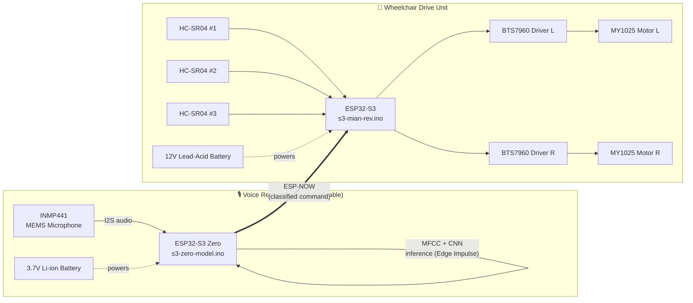
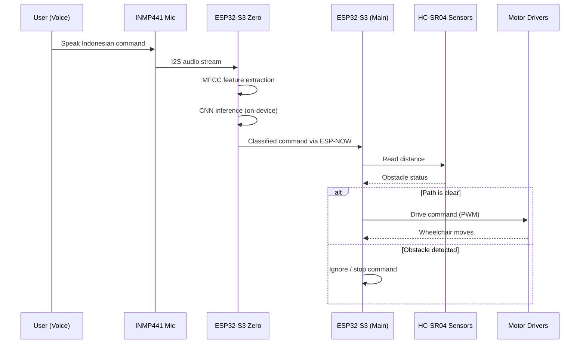

# Edge AI Wheelchair 

Firmware for the undergraduate thesis **"Development of a Self-Propelled Wheelchair with Edge AI-Based Voice Control Using a CNN Model and MFCC Feature Extraction."**

The system uses **two microcontrollers**: one dedicated to **voice recognition (ESP32-S3 Zero)** and another for the **wheelchair drive system (ESP32-S3)**. Communication between the two microcontrollers is performed locally over **ESP-NOW**, eliminating cloud dependency and enabling a responsive, fully offline system.

The project recognizes Indonesian voice commands directly on-device using an Edge AI approach with a **CNN model** and **MFCC feature extraction**. The recognized command is transmitted to the drive controller to execute the corresponding wheelchair movement.

---

## System Architecture



**Key idea:** the wearable voice module and the wheelchair controller are two independent ESP32-S3 boards, each with its own power source, linked wirelessly over ESP-NOW — no Wi-Fi router, no internet, no cloud API calls.

---

## How It Works



1. The **INMP441** microphone captures an Indonesian voice command.
2. The **ESP32-S3 Zero** performs on-device inference using the CNN + MFCC model.
3. The recognized command is transmitted to the **ESP32-S3** via **ESP-NOW**.
4. The ESP32-S3 checks the **HC-SR04** safety sensors.
5. If the path is safe, the wheelchair executes the corresponding movement via the **BTS7960** motor drivers.

---

## Features

- 🗣️ Indonesian voice command recognition
- 🧠 On-device CNN + MFCC inference (no cloud)
- 📡 ESP-NOW wireless link between the two microcontrollers
- ⚙️ Dual MY1025 DC motor control via BTS7960 drivers
- 🚧 Obstacle detection using HC-SR04 ultrasonic sensors
- ⚡ Fully offline, lightweight, real-time architecture

---

## Firmware Structure

```text
.
├── s3-zero-model.ino   # ESP32-S3 Zero firmware (voice recognition)
├── s3-mian-rev.ino     # ESP32-S3 firmware (wheelchair controller)
└── README.md
```

| File | Target board | Role |
|---|---|---|
| `s3-zero-model.ino` | ESP32-S3 Zero | Captures audio, runs MFCC + CNN inference, sends command over ESP-NOW |
| `s3-mian-rev.ino` | ESP32-S3 | Receives command, checks ultrasonic sensors, drives the motors |

---

## Hardware

| Component | Qty | Used for |
|---|---|---|
| ESP32-S3 Zero | 1 | Voice recognition (wearable unit) |
| ESP32-S3 | 1 | Wheelchair drive controller |
| INMP441 MEMS microphone | 1 | Audio capture (I2S) |
| MY1025 DC motor | 2 | Wheelchair propulsion |
| BTS7960 motor driver | 2 | Motor drive (one per motor) |
| HC-SR04 ultrasonic sensor | 3 | Obstacle/safety detection |
| 12V lead-acid battery | 1 | Powers the drive system |
| 3.7V Li-ion battery | 1 | Powers the voice recognition module |

The voice recognition unit is powered independently from the drive system, allowing the wearable microphone module to operate separately from the wheelchair controller.

---

## Software / Model

- **MFCC** for feature extraction
- **CNN** for classification
- **Edge Impulse** for training and deployment as an Arduino library

The model recognizes six classes:

| Class | Meaning |
|---|---|
| Maju | Forward |
| Mundur | Backward |
| Kiri | Left |
| Kanan | Right |
| Stop | Stop |
| Derau | Noise / no command (background) |

Edge Impulse project: https://studio.edgeimpulse.com/public/1018573/live

---

## Performance

Based on the thesis evaluation:

| Metric | Result |
|---|---|
| Model accuracy | **93.33%** |
| Average Word Error Rate (WER) | **6%** |
| Average end-to-end latency | **0.69 s** |
| Max additional payload (stable operation) | **10 kg** |

These results show the architecture is lightweight enough for real-time execution directly on ESP32-class microcontrollers.

---

## Requirements

- Arduino IDE or PlatformIO
- ESP32 board package
- ESP32-S3 board support
- ESP32-S3 Zero board support

**Required libraries:**

- WiFi
- ESP-NOW
- INMP441 / I2S Audio
- HC-SR04 library
- BTS7960 motor driver library
- Edge Impulse Arduino Library

---

## Installation

1. Open `s3-zero-model.ino` in Arduino IDE and select the **ESP32-S3 Zero** board.
2. Open `s3-mian-rev.ino` in Arduino IDE and select the **ESP32-S3** board.
3. Install all required libraries listed above.
4. Select the correct board and COM port for each device.
5. Upload each firmware to its corresponding microcontroller.
6. Power on both units and test the voice commands.

---

## Notes

This repository contains the firmware developed for the undergraduate thesis project *"Development of a Self-Propelled Wheelchair with Edge AI-Based Voice Control Using a CNN Model and MFCC Feature Extraction"* by **Fahril Maula Tanzil Huda**. The entire voice recognition pipeline runs locally on embedded hardware, enabling a completely offline solution without relying on cloud-based speech recognition services.

## License

-
